# Anıl

I make mobile apps on my own and keep them running after launch. Mostly React Native and Postgres, some Swift.

**[Bodica](https://github.com/AnilBurcu/bodica)** teaches body language. Apple made me ask before sending a photo to Gemini. Fair enough. [App Store](https://apps.apple.com/app/id6756843038) · [Google Play](https://play.google.com/store/apps/details?id=com.anilburcu.readbody)

**[Radora](https://github.com/AnilBurcu/radora-app)** teaches English through articles built from the words you're learning. Not out yet.

**[Alışkanlıklar](https://github.com/AnilBurcu/aliskanliklar-showcase)** is a habit tracker with a jar instead of a streak. Once an object settles, it never moves again.

<picture>
  <source media="(prefers-color-scheme: dark)" srcset="jar-dark.svg">
  
</picture>

My last year of commits, one stone per week. The bigger the stone, the busier the week.

Things I got tired of doing by hand: [keep-supabase-alive](https://github.com/AnilBurcu/keep-supabase-alive) · [supabase-free-backup](https://github.com/AnilBurcu/supabase-free-backup) · [claude-code-react-native](https://github.com/AnilBurcu/claude-code-react-native) · [raycast scripts](https://github.com/AnilBurcu/Raycast-Extensions)

Taking a few client projects: [anl@icodex.dev](mailto:anl@icodex.dev)
